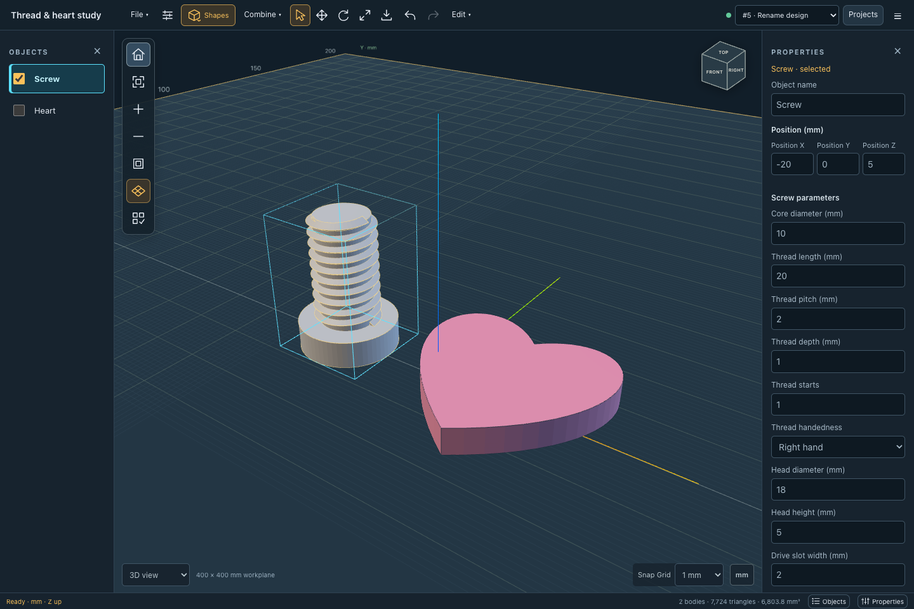
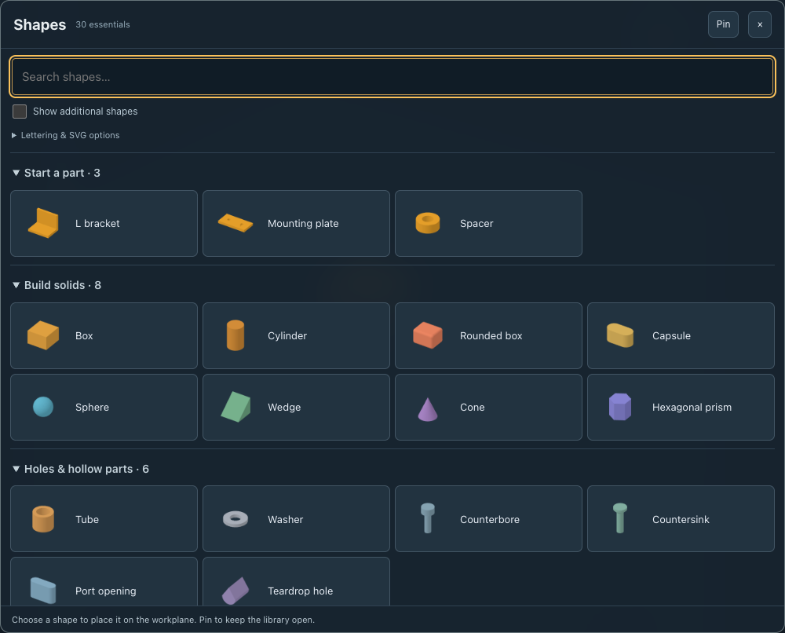
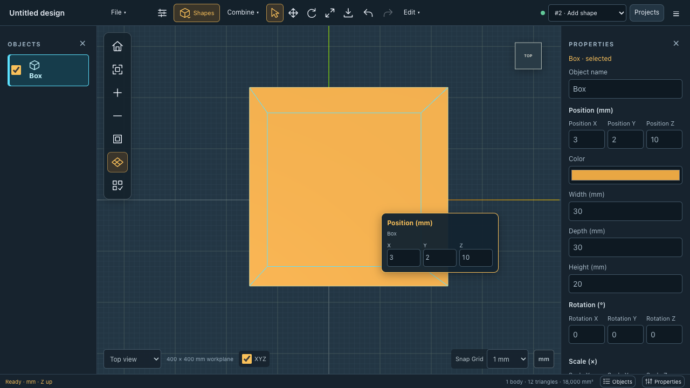

# Brickwright CAD

**Verification runs locally.** GitHub Actions is disabled while this repository
is private to preserve the owner’s Free-tier CI allowance. See [local checks](docs/CI.md).

A 3D solid editor and the same editor that uses Manifold for mesh-solid operations and Three.js for rendering.

Optional native hosts
provide macOS and iPad apps without changing the reusable editor.

**Status:** working early CAD workbench, see the [roadmap](docs/ROADMAP.md) for current limits.



## Run locally

Requires Node **22.18+** and npm.

```sh
npm ci
npm run build
npm run preview
```

Open http://127.0.0.1:4317/ for the standalone workbench, or
http://127.0.0.1:4317/embedded.html for the host integration demo. `npm run dev`
builds the library packages before starting Vite; after changing a package,
rerun `npm run build:packages` (or `npx tsc -b --watch` in another terminal).

For the native iPad host and Brickwright-keychain signing, see [docs/IPAD.md](docs/IPAD.md).
For the native macOS app, run `npm run mac:build` followed by `npm run mac:run`.
The latter installs into `~/Applications` and gracefully refreshes an existing app.
See [docs/MACOS.md](docs/MACOS.md) for native verification, storage and build details.

The delivered scope and exclusions are in [docs/SCOPE.md](docs/SCOPE.md).
Host APIs, package boundaries and the later Brickwright wiring are documented
in [docs/INTEGRATION.md](docs/INTEGRATION.md). The roadmap, including the possible
CrispMesh scan-to-CAD path, is in [docs/ROADMAP.md](docs/ROADMAP.md).

- Start with 30 everyday shapes and parametric bracket/plate/spacer templates;
  find 22 further presets under Additional shapes or search. The library retains
  geometry-derived thumbnails,
  pinning, filled SVG icons, original block lettering, name tags and QR content.
  Box/cylinder/sphere expose dimensions. Screws, threads, nuts and hearts expose
  editable generator controls; remaining catalog presets currently expose transforms
  and retained operands rather than complete generator parameters.
- Create rectangle/circle sketches and retained extrusions with dimensions or
  formulas, principal planes and symmetry. Reopen their inputs after booleans,
  save/reload and history restore. See [the parametric model](docs/PARAMETRIC-MODEL.md)
  and [sketch mounting plate](examples/parametric-sketch-plate.bcad).
- Retain and edit the operands of union, subtract and intersection operations.
- Optionally drive primitive dimensions and transforms with named parameters,
  unit-aware formulas and dependency recomputation, including retained boolean
  operands. See [the parameter tutorial](docs/PARAMETERS.md) and editable
  [mounting-plate example](examples/parametric-mounting-plate.bcad).
- Multi-select with object checkboxes, Shift-click or long press. Subtraction
  uses the first selected body as its base and later bodies as cutters.
- Navigate with a camera-synchronized view cube, six principal views, Home/Fit,
  zoom controls and perspective/orthographic projection.
- Model on a numbered 400 × 400 mm workplane with 1 mm minor / 10 mm major lines.
  Snap spacing is independent of the displayed ruler grid.
- Move/rotate/scale with handles or numeric properties; nudge with arrow keys.
  Optional on-canvas XYZ inputs and the inspector update live during drags;
  enable XYZ below the workplane or in Settings. Drag previews do not fill history.
  Drop selected top-level bodies onto the workplane, including rotated bodies.
- A single-row workbench with Shapes, Select/Move/Rotate/Scale, and File/Edit/Combine
  menus. Escape or V returns to normal selection and direct dragging. Cyan bounds
  and highlighted object rows identify selection. Objects lists actual bodies;
  generic boolean source shapes are edited separately in Properties.
- Native macOS File/Edit/View/Object menus share the workbench command API,
  including real model Cut/Copy/Paste, Duplicate/Delete and native file panels.
  Clipboard transfers preserve recipes, formulas, materials and internal joints.
- About with acknowledgements, a searchable Projects library, Settings and a compact
  iteration selector. Navigation does not change document history.
- Undo/redo and independent sessions for each embedded instance. The standalone
  host additionally retains every saved iteration, with model selection, named
  checkpoints, branching restore and history inside saved `.bcad` projects. No automatic
  pruning; large immutable mesh assets are shared by SHA-256 content address.
- Save one editable `.bcad` file containing the model and its complete saved history.
  Legacy snapshot `.bcad` and `.bcadhistory` files still open. Import closed STL meshes.
- The macOS library automatically writes history-inclusive project files to a folder
  selected in Settings; the default is `~/Documents/Brickwright CAD`. Existing WebKit
  library projects are copied on startup. Conflicting histories are never overwritten.
- File → Export chooses binary STL or 3MF for printing. These exports contain meshes, not the
  editable project graph; 3MF currently exports geometry without materials.
- The standalone app autosaves on this device and can run offline after the
  production bundle's service worker has installed. Keep portable project files
  as backups. Corrupted autosaves are offered for recovery before replacement.

Geometry evaluation runs in a worker. Export is disabled while the displayed
geometry is stale or failed. The previous geometry stays visible with an error
if an edit fails. Imported geometry is built before replacing the current design.

## Packages

| Package | Responsibility |
| --- | --- |
| `@brickwright/cad-core` | Versioned documents, validation, commands, selection and undo |
| `@brickwright/cad-geometry` | Headless Manifold evaluation, STL/3MF |
| `@brickwright/cad-editor` | Framework-independent DOM/Three editor, isolated worker |
| `@brickwright/cad-history` | Append-only IndexedDB revisions, shared content, ancestry and portable archives |
| `@brickwright/cad-physics` | Qualified convex compounds, actual solid mass/inertia and headless Jolt worlds |
| `@brickwright/cad-brickwright` | SB3 sidecar, LDraw coordinate conversions and part-mesh handoff |

The standalone app is one host. File access and persistence are injected rather
than implemented inside the reusable core/editor. Each editor owns only its
mount target and must be disposed when its host unmounts it.

```sh
npm test
npx playwright install chromium webkit
npm run test:e2e
```

The source provenance for reused Brickwright BSD arithmetic is recorded with
commit and SHA-256 hashes in `docs/brickwright-provenance.json`. Third-party
notices are in [THIRD-PARTY-NOTICES.md](THIRD-PARTY-NOTICES.md).

The optional parametric CAD architecture and reference-UX acceptance criteria are
in [docs/UX-AND-PARAMETRIC.md](docs/UX-AND-PARAMETRIC.md). Named parameters and
formula bindings are implemented; the current mesh-solid
editor is not a complete constrained-sketch/B-rep CAD. Stored iterations are
separate from bounded editing undo. Local storage is finite: preserve portable
backups; current full-history backup/import is limited to 64 MiB per archive.

The physics package uses the existing MIT Brickwright Jolt fork. It is not yet
a simulation tab in the standalone UI. An explicit rigid preview is distinct
from a qualified spring, thread, snap-fit, belt or gear mechanism; unconfigured
mechanical models are refused. Run `node scripts/qualify-catalog-physics.mjs`
for the full catalog qualification report after building packages.

## License and development

Original project code is [BSD-3-Clause](LICENSE). Runtime dependencies include
Three.js (MIT), Manifold (Apache-2.0), and the Brickwright Jolt fork (MIT).
[Third-party notices](THIRD-PARTY-NOTICES.md) cover bundled components; native
Apple frameworks are supplied by the operating system. The project incorporates
no Layerling implementation or artwork.

See [CONTRIBUTING.md](CONTRIBUTING.md) for development, verification and package
boundaries. Models stay on your device unless you export or share them. Retain
portable backups; local autosave is not off-device backup.





The [parametric CAD strategy](docs/PARAMETRIC-CAD-STRATEGY.md) compares modeling
workflows, records the FluidCAD/Solidcraft/Macad3D reviews and defines the next solver,
feature, component and exact-kernel milestones.
