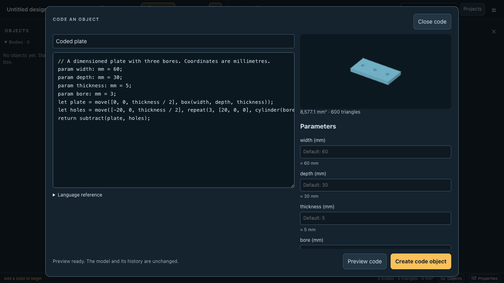

# Code an object

Choose **Code** in the workbench or **Object → Code an Object…** on macOS.
The original CAD Script language describes one retained construction. Preview
builds the solid without changing the model; Create/Apply preflights the complete
model and saves one undoable edit. Errors preserve the draft and last valid solid.
Select the object and choose Code again, or expand its **Code & parameters** in
the browser, to reopen the definition. Code operands remain editable after booleans.

```text
param width: mm = 60;
param depth: mm = 30;
param thickness: mm = 5;
param bore: mm = 3;
let plate = move([0, 0, thickness / 2], box(width, depth, thickness));
let holes = move([-20, 0, thickness / 2],
                 repeat(3, [20, 0, 0], cylinder(bore, thickness * 2)));
return subtract(plate, holes);
```

Open the [example project](../examples/coded-three-bore-plate.bcad), or copy
the [example source](../examples/three-bore-plate.cadcode).

Parameters appear beside the source. Enter expression overrides, or clear a field
to use its source default. Inputs are scoped to this object, independently of
model parameters; copying an object retains independent local inputs. Updating
source preserves object ID, placement, appearance and physics settings. Units
are millimetres/degrees; scalar means dimensionless. Expressions support named
parameters, `+ - * /`, parentheses and explicit mm/cm/m/in/deg/rad units.
The final `return` is required. Named shapes support forward references; cycles
and duplicate declarations are errors. `//` starts a comment.

| Function | Meaning |
| --- | --- |
| `box(width, depth, height)` | Centred box |
| `cylinder(radius, height[, segments])` | Centred cylinder along Z |
| `sphere(radius[, segments])` | Centred sphere |
| `union(a, b, ...)` | Combine solids |
| `subtract(base, cutter, ...)` | Remove cutters from base |
| `intersect(a, b, ...)` | Common solid |
| `move([x,y,z], shape)` | Translate in millimetres |
| `rotate([x,y,z], shape)` | Rotate in degrees |
| `scale([x,y,z], shape)` | Positive axis scale |
| `repeat(count, [dx,dy,dz], shape)` | Union a bounded linear repetition |

Nested transforms execute from the inside out. Each returned construction is
one rigid body, including disconnected components; make separate objects for
separate simulation bodies. Code regenerates actual Manifold mesh solids and
uses the existing Jolt collision qualification/invalidation pipeline. Changing
source or overrides invalidates old collision preparation. This does not create
mechanical joints or flexible material simulation automatically.

Source and overrides live in document version **4** and are included in the normal
history-inclusive `.bcad` archive. Existing v1–3 projects still open. Older app
versions reject v4 rather than flattening or silently losing code. Preview creates
no saved iteration. Restoring an iteration retains later work.

The interpreter accepts a bounded modeling language, not JavaScript, Haskell or
`.scad` files. There is no `eval`, arbitrary imports, filesystem or network access.
Current limits: 32 KiB UTF-8 source, 8,192 tokens, 128 statements, depth 32,
256 expanded shape nodes, 200,000 estimated faces, repeat count 64 and curve
segments 12–96 (default 48). The normal expression and document limits also apply.
General user-defined modules, conditional modeling, arbitrary loops, 2D code
profiles and implicit surfaces are future work.



## Reference ideas and implementation boundary

These comparisons concern public documentation, not copied implementation:

- [OpenSCAD](https://github.com/openscad/openscad): retained declarative source,
  parameter-driven reuse, CSG and nested transforms. Its implementation was not
  used. Our language is independent and does not promise OpenSCAD compatibility.
- [JSCAD](https://github.com/jscad/OpenJSCAD.org): separate reusable modeling
  modules from browser and command-line hosts. Its MIT project is a potential
  permissive ecosystem reference; no JSCAD code or dependency was added here.
- [ImplicitCAD](https://github.com/Haskell-Things/ImplicitCAD): programmatic reuse,
  rounded constructions, twisted extrusion and implicit functions whose zero
  boundary describes a surface. This AGPL project is an ideas-only reference;
  no implementation was read or incorporated. An optional future implicit backend
  must specify field units, bounds, meshing tolerance and collision validation.
  It must retain the source definition rather than pretending a sampled mesh is
  an exact B-rep. No implicit backend has been adopted.

The first milestone uses our existing BSD core and Apache-licensed Manifold;
there are no new production dependencies. See [CAD strategy](PARAMETRIC-CAD-STRATEGY.md)
and the [MCP interface](MCP.md) for the shared headless path.

The Code an object dialog now includes 34 original examples: primitives, units,
forward references, mounting plates, washers, spacers, sleeves, brackets, trays,
lids, handles, clips, guides, patterns and Boolean constructions. Load example
replaces only the current draft; Preview is noncommitting. New created code bodies
are placed on the workplane; subsequent definition edits preserve their pose.
The core exports `codeExamples` and `codeExampleProgram(id)`; MCP `cad_code_help`
returns the same sources with locale-specific titles. Every shipped example is
compiled, evaluated and STL-round-tripped as a positive-volume solid in tests.
