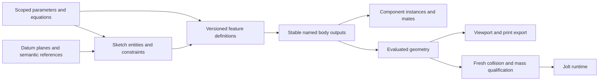

# From a solid editor to parametric CAD

Owner direction, 2026-11-13: learn from Fusion, Onshape, SolidWorks, OpenSCAD,
FreeCAD, SketchUp, FluidCAD, Solidcraft and Macad3D. Preserve an independently designed
interface and permissive dependencies. This is an engineering plan, not a claim
of parity with those products. The implemented v3 schema is specified separately
in [PARAMETRIC-MODEL.md](PARAMETRIC-MODEL.md).

## What to learn from the established workflows

| Reference | Documented approach | Decision for Brickwright CAD |
| --- | --- | --- |
| [Fusion: modeling modes](https://help.autodesk.com/cloudhelp/ENU/Fusion-Designs/files/ASM-DESIGN-MODELING-MODES.htm) and [parameters](https://help.autodesk.com/cloudhelp/ENU/Fusion-Model/files/SLD-MODIFY-PARAMETERS.htm) | Retained feature timeline and dimensions that recompute downstream operations; a distinct direct mode | Keep editable inputs and a dependency graph. Direct interaction must update an input or create a deliberate feature, without silently removing a formula. |
| [Onshape: feature lists](https://cad.onshape.com/help/Content/PartStudio/features_and_parts_lists.htm) and [variables](https://cad.onshape.com/help/Content/PartStudio/variable.htm) | Features, sketches and variables participate in the Part Studio workflow | A construction view should expose dependencies, editing and suppression. Our current global parameter DAG allows forward references; do not accidentally import ordered-variable semantics into it. |
| [SolidWorks: fundamentals](https://www.solidworks.com/sites/default/filesd10/2025-04/SOLIDWORKS_Fundamentals_3D_Design_Simulation.pdf) | Sketch/feature design intent and rebuilding parts from it | Verify what happens when an early dimension changes, not merely whether a tool produced a mesh once. |
| [OpenSCAD: modules](https://files.openscad.org/documentation/manual/User-Defined_Functions_and_Modules.html) | Reusable, parameterized constructions expressed in code | Support a bounded declarative modeling API over the same definitions as the GUI. Code should be optional; do not execute arbitrary scripts merely by opening a project. |
| [FreeCAD: sketches](https://www.freecad.org/manual/a-freecad-manual.pdf) and [feature editing](https://github.com/FreeCAD/FreeCAD-documentation/blob/main/wiki/Feature_editing.md) | Geometric entities plus constraints; downstream features; care with sketch support and topology changes | Add a real constraint model and datum-based attachments. Triangle indexes and incidental face order cannot be persistent references. |
| [SketchUp: components](https://help.sketchup.com/en/sketchup/components) and [dynamic components](https://help.sketchup.com/en/sketchup/making-dynamic-component) | Reusable component definitions and configurable attributes | Keep quick selection and manipulation, then add explicit definition/instance ownership and editable exposed parameters. |

These are complementary ideas. A scripted CSG model, an unconstrained push/pull
model and a constrained mechanical feature model are not interchangeable just
because all display an editable number.

## The common model we need

Design inputs, evaluated results, saved iterations and runtime simulation state
must remain distinct. A feature tree describes construction in one version;
the compact iteration selector restores complete versions. Neither replaces the
other. A physical simulation must not write thousands of solver steps into the
CAD definition or its saved history.

Before a general feature timeline is shipped, extend our definitions with:

- **Parameter identity and scope:** stable IDs independent of labels, project and
  part scopes, types/units, expressions, bounds and exposed controls. Renaming
  must preserve references. Copy-as-independent and shared-definition instances
  must be explicit. Our current global symbols and paste namespaces are an initial
  implementation, not a complete component parameter system.
- **Sketch entities and constraints:** stable point/line/arc/circle IDs, explicit
  construction geometry, dimensional and geometric constraints, driving versus
  reference measurements, profile regions and a defined plane/frame. A rectangle
  template is useful but is not a general sketch solver.
- **Features and outputs:** kind and evaluator version, typed inputs, explicit
  dependencies, suppression, output identities, local placements and structured
  errors. Keep body identity distinct from the last operation producing it before
  implementing multi-output operations and persistent assemblies.
- **References:** semantic datum/profile/feature-output references with an explicit
  resolver and ambiguity diagnostics. Extend to exact faces/edges only with a
  naming/lineage strategy and repair workflow. A numeric face or triangle index is
  insufficient.
- **Recompute:** deterministic dependency order, content identities, cancellation,
  incremental invalidation and last-good results clearly marked stale. A failed
  feature blocks downstream output, printing and simulation; it must not silently
  fall back to unrelated geometry.
- **Components and configurations:** immutable definitions, instances with parameter
  overrides and rigid placements, optional variant tables, and mates attached to
  persistent frames. Nonuniform part scaling changes geometry; it cannot be treated
  as a rigid assembly placement.

Saved versions continue to contain complete definitions and external asset
identities. New schemas need explicit validation/migration and older-file fixtures;
old snapshots are not rewritten or baked to meshes as a convenience.

## Solver and kernel responsibilities

The sketch solver solves relationships, not tessellation. Its interface needs
remaining degrees of freedom, violated and redundant constraints, residuals,
orientation/branch continuity, deterministic budgets and cancellation. Dragging a
constrained point uses a temporary target while preserving its constraints. Only
an accepted result becomes a document edit. Numerical convergence alone is not a
proof that the intended branch or orientation was retained.

A geometry backend builds solids from the solved profiles and features. Rendering
uses a tessellation; exact features must retain exact definitions and topology.
Our current Manifold backend is useful for mesh solids and print workflows, but
does not become an exact B-rep/STEP kernel by adding a feature list.

Keep a backend adapter and capability contract. An exact-kernel experiment must
pass independent volume/bounds/analytic fixtures, fillet and shell edge cases,
STEP reopen, semantic-reference rebuilds, malformed inputs, cancellation, memory
limits and native/iPad WebAssembly tests. Do not replace the working mesh backend
or promise support for every operation based on upstream feature lists.

Physics consumes the evaluated output with an explicit tolerance and source key.
Changing a design requires fresh qualification. Mechanical fit, elastic behavior
and manufacturing tolerances require additional evidence beyond a successful
rigid-body drop test.

## Source review: FluidCAD and Solidcraft

Reviewed 2026-11-13. No source or assets from either repository were incorporated
in this update. Existing/new UI remains independently authored.

### FluidCAD

Pinned review: [5b8e897](https://github.com/Fluid-CAD/FluidCAD/tree/5b8e897b4a06ec1e5fe0647527f7f40808d7de18).
The [README](https://github.com/Fluid-CAD/FluidCAD/blob/5b8e897b4a06ec1e5fe0647527f7f40808d7de18/README.md)
describes a shared graphical/code model. The inspected
[part API](https://github.com/Fluid-CAD/FluidCAD/blob/5b8e897b4a06ec1e5fe0647527f7f40808d7de18/lib/core/part.ts),
[parameter API](https://github.com/Fluid-CAD/FluidCAD/blob/5b8e897b4a06ec1e5fe0647527f7f40808d7de18/lib/core/param.ts)
and [registry](https://github.com/Fluid-CAD/FluidCAD/blob/5b8e897b4a06ec1e5fe0647527f7f40808d7de18/lib/param-registry.ts)
make part interfaces, scoped values, instance overrides and configurations explicit.
The lesson for us is to expose meaningful part inputs and keep assembly instances
separate from definitions. Source-location tracking is useful for a future code
view, but our canonical document should remain validated data initially.

Its [top-level license](https://github.com/Fluid-CAD/FluidCAD/blob/5b8e897b4a06ec1e5fe0647527f7f40808d7de18/LICENSE.txt)
is MIT; [its package](https://github.com/Fluid-CAD/FluidCAD/blob/5b8e897b4a06ec1e5fe0647527f7f40808d7de18/package.json)
depends on `ocjs-fluidcad`, and its README identifies OpenCascade as the kernel.
[OCCT's own license statement](https://github.com/Open-Cascade-SAS/OCCT/blob/master/README.md)
specifies LGPL 2.1 with an exception. That does not satisfy the owner's current
MIT/Apache/BSD-like dependency requirement. FluidCAD is an architecture reference;
its MIT wrapper is not approval to adopt that entire runtime.

### Solidcraft

Pinned review: [9686f93](https://github.com/tangency-labs/solidcraft/tree/9686f9314ad587c52b832f045fcd7208931bf131).
The inspected [architecture](https://github.com/tangency-labs/solidcraft/blob/9686f9314ad587c52b832f045fcd7208931bf131/docs/architecture.md)
separates modeling, document evaluation, I/O and commands from the front end.
Its [reference walker](https://github.com/tangency-labs/solidcraft/blob/9686f9314ad587c52b832f045fcd7208931bf131/crates/doc/src/feature_refs.rs)
centralizes dependency/remapping behavior; some reference kinds still use names.
Our lesson is to make remapping a shared contract and use stable IDs consistently,
not duplicate reference handling across clipboard, rename, deletion and assembly.
Its [model-cache implementation](https://github.com/tangency-labs/solidcraft/blob/9686f9314ad587c52b832f045fcd7208931bf131/crates/doc/src/model_cache.rs)
illustrates shared evaluated states and separate kernel bodies. Such caches are
rebuildable acceleration data, distinct from permanent user revision retention.

The inspected [solver](https://github.com/tangency-labs/solidcraft/blob/9686f9314ad587c52b832f045fcd7208931bf131/crates/sketch/src/solver.rs)
uses connected systems, numerical solving, rank/DOF analysis and continuity/error
reporting. A future solver evaluation must include these behaviors, not just a
few constraints that happen to converge. The
[sketch crate](https://github.com/tangency-labs/solidcraft/blob/9686f9314ad587c52b832f045fcd7208931bf131/crates/sketch/Cargo.toml)
is separate, but its full dependency closure still needs qualification before reuse.

The [NOTICE](https://github.com/tangency-labs/solidcraft/blob/9686f9314ad587c52b832f045fcd7208931bf131/NOTICE)
separates MIT/Apache modeling code from protected interface material.
[LICENSE-BRAND](https://github.com/tangency-labs/solidcraft/blob/9686f9314ad587c52b832f045fcd7208931bf131/LICENSE-BRAND)
places the UI kit, look, theme and brand under separate restrictions. Those modules,
design tokens, assets and visual design are excluded from our implementation.

The vendored [Solidcore README](https://github.com/tangency-labs/solidcraft/blob/9686f9314ad587c52b832f045fcd7208931bf131/solidcore/README.md)
identifies an Apache-2.0 Rust B-rep kernel derived from NVIDIA's SMLib, with a
WebAssembly target. It also calls out experimental APIs and deferred coverage.
This is a concrete exact-backend candidate for a separate benchmark and dependency
audit, not a kernel adopted or certified by this update.

### Macad3D

Pinned review: [72ee7d1](https://github.com/Macad3D/Macad3D/tree/72ee7d12abc5c346c2df02c1f711145abd213d15).
Its [README](https://github.com/Macad3D/Macad3D/blob/72ee7d12abc5c346c2df02c1f711145abd213d15/Readme.md)
describes model-making workflows and its .NET/C#/C++/CLI/OCCT stack; the
[top-level license](https://github.com/Macad3D/Macad3D/blob/72ee7d12abc5c346c2df02c1f711145abd213d15/License.txt)
is MIT. As with FluidCAD, an MIT application layer does not make OCCT a
permissively licensed backend under the owner's dependency policy. The Windows
host stack is also not a drop-in shared Mac/iPad editor.

The inspected [Shape](https://github.com/Macad3D/Macad3D/blob/72ee7d12abc5c346c2df02c1f711145abd213d15/Source/Macad.Core/Shapes/Shape.cs)
model retains body ownership, predecessor and suppression state, separate local
and transformed geometry, and invalidation/rebuild behavior.
[ModifierBase](https://github.com/Macad3D/Macad3D/blob/72ee7d12abc5c346c2df02c1f711145abd213d15/Source/Macad.Core/Shapes/ModifierBase.cs)
tracks operands/dependants and handles different body coordinate systems.
[SubshapeReference](https://github.com/Macad3D/Macad3D/blob/72ee7d12abc5c346c2df02c1f711145abd213d15/Source/Macad.Core/Shapes/SubshapeReference.cs)
records owning shape identity plus semantic/index information and source
references for derived subshapes. This reinforces the need for operation lineage
and a resolver, rather than treating a triangle index as persistent identity.

The inspected [Body](https://github.com/Macad3D/Macad3D/blob/72ee7d12abc5c346c2df02c1f711145abd213d15/Source/Macad.Core/Topology/Model/Body.cs)
keeps placement separate from its root/current construction. Its
[UndoHandler](https://github.com/Macad3D/Macad3D/blob/72ee7d12abc5c346c2df02c1f711145abd213d15/Source/Macad.Core/Framework/Undo/UndoHandler.cs)
groups pending changes at commit. The useful behavior is one accepted user action
per undo step; a bounded editing undo stack must remain separate from our
permanent saved iteration journal.

For us the concrete priorities are a distinct body/output ownership model,
explicit cross-part frames, common dependency invalidation, retained suppression
and undoable editing. Its model/interaction separation is a useful reference;
no Macad3D code or interface has been transplanted.

## Delivery order and acceptance

1. **Usable direct interaction and exposed inputs — this update.** Practical
   bracket/plate/spacer starting parts, curated everyday shapes, optional extras,
   visible design inputs and live XYZ transform readouts. Dragging previews one
   change; release commits one edit; Escape restores the committed definition.
2. **Sketch/entity/solver contract and bounded prototype.** Points, lines, circles
   and arcs; coincidence, horizontal/vertical, distance, radius, angle, parallel
   and perpendicular constraints. Report DOF/conflicts/redundancy and preserve
   branches during drag. Compare an independently implemented prototype with
   permissively licensed solver candidates before choosing a production backend.
3. **Part ownership and feature editing.** Scoped parameter IDs, named body outputs,
   datum planes, an editable construction view with suppression/rollback, hole,
   revolve, mirror and linear/circular pattern features. Add align/measure/snap
   workflows before exotic decorative presets.
4. **Exact-backend qualification in parallel.** Evaluate Solidcore behind a narrow
   adapter with independent fixtures and WASM memory/latency measurements. STEP,
   fillet, chamfer and shell enter the product only after their capabilities and
   failure handling pass those tests. SMLib WASM and WASMLib are further
   candidates; kernelCAD's reference-part scorecard is a suitable gate. See
   [the kernelCAD review](KERNELCAD-REVIEW.md) for what was adopted (MIT gear
   and mesh-printability code) and why a kernelCAD fork is deferred.
   SMLib (`@classcad/smlibwasm`) standalone qualification: [experiments/exact-kernel](../experiments/exact-kernel/README.md).
5. **Components, configurations and assembly.** Explicit linked versus independent
   instances, parameter variants, stable mate frames and qualified Jolt actuators.
   Share the same headless command layer with Brickwright and CrispMesh.
6. **Optional code view.** A bounded declarative representation and command API over
   the same model. Opening a saved project must not require executing arbitrary JS.

Acceptance fixture: build a dimensioned bracket with a constrained hole pattern,
change wall thickness and hole spacing, reopen an earlier saved iteration, create
several parameter variants, mate a pin/hinge, export/reopen, and qualify the resulting
rigid geometry. Complete the basic modeling task on an iPad without a keyboard.
Pass analytic dimension/volume checks and retain reference identities throughout.
A broad feature list or screenshots alone do not demonstrate this acceptance.
