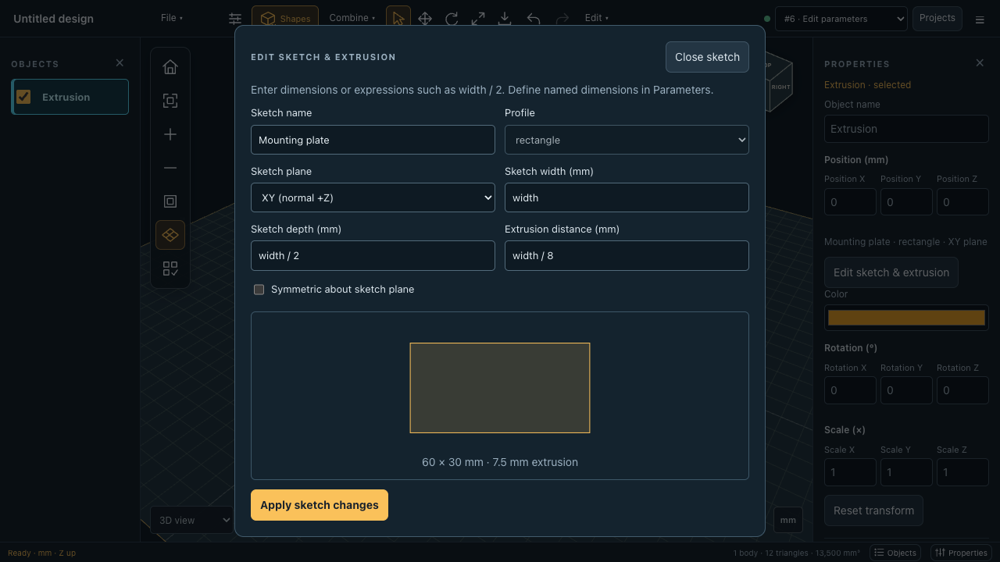

# Parametric modeling contract

Implemented milestone, 2026-11-13. This is the shared model for the standalone
app and future Brickwright/CrispMesh hosts. The BSD core owns definitions and
validation; the geometry worker evaluates them. No new dependency was added.

## Definitions, evaluated geometry and saved iterations

These are three different things:

1. **Design definitions** are canonical: named dimensions, bounded arithmetic
   expressions, analytic sketches, feature inputs, transforms and retained boolean
   operands. IDs identify constructions, not their current tessellation.
2. **Evaluated meshes** are disposable output. Manifold evaluates a validated
   definition; rendering, STL/3MF and Jolt preparation consume that output. A mesh
   must not become the only source of an editable sketch or feature.
3. **Model iterations** are immutable snapshots of the complete definition. They
   preserve design inputs and branches. The feature dependency graph describes
   one snapshot; it is not the user's undo list or their saved iteration list.

Existing primitives and booleans remain editable and can coexist with sketch
features. Parametric modeling stays optional. Importing an STL does not infer a
sketch or recover the author's dimensions.

## Saved schema

Document **version 3** adds `sketches` and the `extrusion` node kind. Versions 1
and 2 remain readable without conversion to meshes. Merely opening an old model
does not change its version. Adding a sketch upgrades only the current document;
old history snapshots remain in their original format. Older applications reject
version 3 rather than opening a damaged approximation.

```ts
type FeatureScalar = number | string; // literal mm, or a unit-aware expression
interface PlanarSketch {
  version: 1;
  id: string;
  name: string;
  plane: 'XY' | 'XZ' | 'YZ';
  profile:
    | { kind: 'rectangle'; id: string; width: FeatureScalar; depth: FeatureScalar }
    | { kind: 'circle'; id: string; radius: FeatureScalar; segments: number };
}
interface ExtrusionFeature {
  kind: 'extrusion';
  featureVersion: 1;
  sketchId: string;
  distance: FeatureScalar;
  symmetric: boolean;
  // Normal SolidNode identity, name, color, transform and physics also apply.
}
```

Sketch/profile and feature IDs survive editing and recomputation. One sketch may
feed multiple extrusion features. Its ID is independent of the feature's ID.
The current model has one solid output per solid node; the feature output uses
that node's stable ID. A boolean retains its input nodes and gains its own output
ID. Combining articulated bodies still requires detaching their joints.

A rectangle is centered about the sketch origin and stays closed and orthogonal
by construction. A circle stays centered and closed, with an analytic radius and
explicit 12–256 segment tessellation. These are constrained profile templates,
not a general sketch constraint solver. Local `(u,v,n)` maps to `(x,y,z)` as:

| Plane | Mapping | Positive extrusion |
| --- | --- | --- |
| XY | `(u,v,n)` | +Z |
| XZ | `(u,-n,v)` | −Y |
| YZ | `(n,u,v)` | +X |

Extrusion distance is positive. Symmetric extrusion spans `−distance/2` to
`+distance/2`; otherwise it starts at the sketch plane. Normal node transforms
apply afterwards. Position/rotation/scale can use existing expression bindings.

Sketch dimensions and extrusion distance accept numbers or the same expressions
as named parameters, such as `plateWidth / 2` or `thickness + 2 mm`. Bare numbers
use mm. Expressions never execute JavaScript. Units, bounds and all referenced
parameters are validated before committing. See [PARAMETERS.md](PARAMETERS.md)
for expression syntax and limits. Up to 256 sketches are supported within the
existing 16 MiB snapshot and 2000 solid-node budgets.

## Graph and errors

`designGraph(doc)` derives a deterministic topological order from canonical
parameter expressions, sketch inputs, extrusion references, transform/dimension
bindings and boolean inputs. Keys are namespaced (`parameter:name`, `sketch:id`,
`feature:id`). `affectedDesignEntries(doc, changedKeys)` reports the changed
entries and transitive dependants, in recomputation order. Parameter names are
currently expression symbols: renaming one requires updating its references.
Sketch/feature identities do not use their displayed names.

The first evaluator rebuilds the document in the geometry worker and memoizes
shared solid inputs within that evaluation. The dependency API establishes the
contract for later incremental caching; it does not yet skip every unaffected
feature across evaluations. Versioned cache keys must include feature inputs,
resolved parameters, dependencies, evaluator/kernel versions and source assets.

`FeatureEvaluationError.diagnostic` contains `source`, stable `id` and `message`.
Geometry-worker errors retain this structured diagnostic. Definition errors
leave the committed model unchanged. The sketch dialog keeps the invalid draft
open for correction and checks the complete resulting solid in the worker before
committing one edit. Unexpected kernel failures in other editing workflows keep
the previous valid display and offer Undo, as before. No failed edit silently
replaces a feature with a mesh.

## Editing, copying and history



The editor's **Sketch** action opens a definition dialog with a dimensioned 2D
preview, plane, formulas, distance and symmetry. **Properties → Edit sketch &
extrusion** reopens that same definition, including a retained boolean operand.
**Parameters → Feature dependencies** shows the graph without adding construction
pieces to Objects. Native macOS also exposes **Object → Sketch and Extrude**.

Headless hosts use these core session methods:

- `addSketch(profile, options)` and `extrudeSketch(sketchId, options)` for reusable
  sketches and distinct features.
- `addSketchExtrusion(profile, options)` for one atomic user action.
- `updateSketch(id, patch)` for all dependants of a shared sketch.
- `editExtrusion(id, {sketch?, distance, symmetric})` for one atomic edit, with
  undo/redo and one archived iteration. Profile ID and kind must remain stable.
- `designGraph`, `affectedDesignEntries`, `evaluateSketch`, `evaluateExtrusion`
  and `resolveDesignReference` for host UI and analysis.

Duplicate copies sketches independently and preserves their formulas linked to
the same named parameters. Shared sketches within the duplicated selection stay
shared within that copy. Clipboard paste remaps sketch/profile/feature IDs and
namespaces colliding parameter names, including formulas inside sketches and
extrusions. Deleting a body removes the solid; sketches remain reusable design
inputs until an explicit sketch deletion workflow is implemented.

The revision store includes sketch definitions in its snapshot header, so full
`.bcad` archives retain formulas and profile identities without a new history
format. [The sketch mounting plate](../examples/parametric-sketch-plate.bcad)
contains two extrusions sharing one circular sketch for its bores.

## References, physics and integration boundaries

`DesignReference` currently resolves **feature outputs** and **sketch profiles**
by ID. Rectangle profile edges have semantic `bottom/right/top/left` identifiers;
a circle has one analytic circumference identifier. These describe construction
geometry, not the arbitrary triangles or faces remaining after a boolean.
Arbitrary face/edge attachments are deliberately not supported yet.

Sketches, formulas and feature inputs participate in `documentGeometryKey`.
Changing them invalidates collision proofs, mass and inertia. Collision generation
uses the actual evaluated extrusion and booleans through the existing Jolt
qualification path; a saved mesh or old certificate cannot stand in for a fresh
qualification. Tests check recomputed mass, refusal of old collision data and a
real Jolt floor drop. Sketch editing of joint-connected bodies currently requires
explicit joint detachment; automatic mate/frame regeneration needs semantic
attachment references first.

Hosts share the same core schema, worker results and revision codec. Keep native
file handling, UI framework, scene cameras and simulation runtime state outside
these definitions. A future simulation session must pin a source geometry key,
and restart/requalify after a design edit.

## Next implementation order

1. Move remaining catalog generators to versioned, headless feature evaluators;
   let their numeric inputs use the same named dimensions and formulas. Existing
   screw/heart recipes remain numeric version-1 recipes for now.
2. Add editable sketch entities (stable point/line/arc IDs), construction geometry
   and a solver boundary. Distance, coincidence, horizontal/vertical, radius and
   angle constraints need IDs, units, driving/reference roles and diagnostics for
   underconstraint, conflict and redundant constraints. A permissive-license
   solver and its dependency closure must be verified before inclusion.
3. Extend profile evaluation to closed wires/holes; add revolve, hole, mirror and
   pattern feature definitions. Add suppression and structured downstream-blocked
   diagnostics while preserving editable inputs. Never implement suppression as
   deleting source definitions.
4. Add semantic feature attachments and a body/assembly identity layer for
   multi-output operations and persistent mates. Resolve references uniquely;
   ambiguous or missing topology must ask for repair, never pick another face.
   Use this contract for joint frames and actuators before an interactive simulator.
5. Add incremental recompute and content-addressed evaluated results. Qualify an
   exact-body/STEP backend separately if required; the current mesh kernel does
   not supply B-rep or stable arbitrary face identities.

These extensions should evolve versioned definitions, not append unrelated UI
state or replayable mouse commands to saved projects. Full sketch constraints,
B-rep/STEP, feature suppression and general FreeCAD parity are not delivered by
this milestone.


The follow-up [CAD strategy](PARAMETRIC-CAD-STRATEGY.md) records the six commercial/
open CAD workflow comparisons and a pinned FluidCAD/Solidcraft architecture review.
Practical `createDesignTemplate` factories now expose their upstream driving inputs
in Properties. On-canvas transforms remain independent of design dimensions:
scaling geometry does not silently rewrite a width equation.
