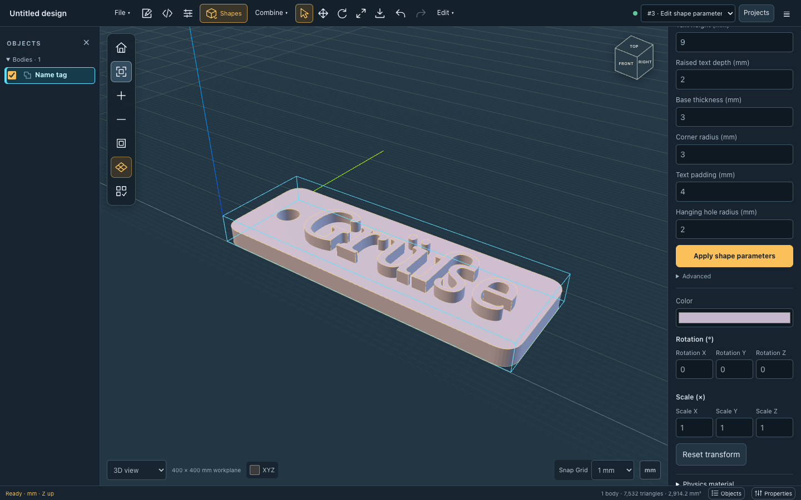

# View preferences and editable lettering

Settings provides background and baseplate colour pickers and Reset view colours.
Colours persist on the device separately from models and history. Embedding hosts
can supply `appearance` when mounting and use `editor.setAppearance(...)` without
implicit shared storage. Invalid colour strings are refused.

Optional axis annotations contain small numbers only. In Select they attach to
coloured axis guides; in Move/Rotate/Scale they follow projected vertices of the
actual visible handles/rings, including local scale orientation. Camera/viewport
changes reposition them. Edge-on/off-screen annotations hide; short guides can
switch ends to stay visible in narrow layouts. Accessible labels and tooltips
identify property/axis/unit. Numeric editing, driven-field protection, live drag
updates, Escape cancellation and one edit per accepted drag remain available.
Properties also shows the resulting X/Y/Z dimensions in millimetres, computed
from the transformed mesh bounds; these measurements are read-only and update
while dragging. Primitive dimensions and scale factors remain editable separately.

New Text and Name tag presets retain text, font and dimensional inputs. Name tags
have rounded corners, adjustable radius/padding/thickness and a hanging hole.

Properties can regenerate the lettering while retaining body identity, placement,
colour and physics settings. Undo, project history and clipboard retain the recipe.
Legacy labels without retained text cannot infer their original lettering from
triangles automatically. Properties offers an empty text field and an explanation:
enter the intended lettering once, then Apply to create the retained recipe. The
existing solid stays unchanged until that explicit action.

Droid Sans, Droid Serif and Droid Sans Mono are bundled Apache-2.0 vector typefaces;
the original block alphabet remains selectable. Droid fonts preserve case and
support German text; unavailable glyphs are rejected rather than silently replaced.
Attribution/license notices are bundled and available in About. No font fetch is
needed at runtime. See packages/editor/src/fonts for the r184 source data/notices.

The iPad host fixes WebKit content zoom at 1×, disables its scroll/zoom bounce and
prevents browser gesture zoom; the CAD canvas keeps its own modeling pinch controls.
iPadOS Accessibility Zoom is separate system magnification, which apps cannot
switch off. If that is what enlarged the entire display, three-finger double-tap
returns from Zoom; its setting is under Settings → Accessibility → Zoom. See
[Apple's Zoom guide](https://support.apple.com/en-euro/guide/ipad/ipad9a245e3e/ipados).
The browser/native guards do not claim to override that accessibility feature.
